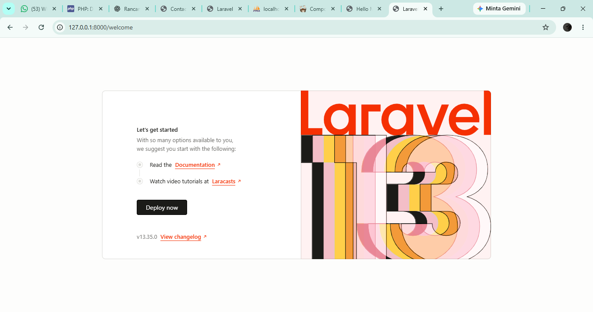

# Tugas Rutin 9 - Laravel Setup

Project ini dibuat untuk memenuhi **Tugas Rutin 9 Pemrograman Web** menggunakan Laravel.

## Identitas

- Nama: Moudy Emellin
- Mata Kuliah: Pemrograman Web
- Framework: Laravel
- Database: MySQL

## Fitur

- Laravel Routing
- Blade View
- Controller
- Model dan Migration
- Koneksi MySQL
- Data dinamis dari array route
- Tailwind CSS CDN
- Bonus route parameter `/hello/{nama}`

## Route

| Route | Keterangan |
|---|---|
| `/` | Halaman Home |
| `/about` | Halaman About |
| `/contact` | Halaman Contact |
| `/hello/{nama}` | Bonus route parameter |
| `/welcome` | Laravel Welcome Page |

## Instalasi Project

1. Clone repository:

```bash
git clone https://github.com/moudyemellin-dev/TugasWeb-P9-LaravelSetup.git
```

2. Masuk ke folder project:

```bash
cd TugasWeb-P9-LaravelSetup
```

3. Install dependency:

```bash
composer install
```

4. Salin file environment:

```bash
copy .env.example .env
```

5. Generate application key:

```bash
php artisan key:generate
```

6. Buat database MySQL:

```text
laravel_setup_db
```

7. Atur `.env`:

```env
DB_CONNECTION=mysql
DB_HOST=127.0.0.1
DB_PORT=3306
DB_DATABASE=laravel_setup_db
DB_USERNAME=root
DB_PASSWORD=
```

8. Jalankan migration:

```bash
php artisan migrate
```

9. Jalankan server Laravel:

```bash
php artisan serve
```

10. Buka di browser:

```text
http://127.0.0.1:8000
```

## Struktur Folder

```text
TugasWeb-P9-LaravelSetup/
├── app/
│   ├── Http/Controllers/PageController.php
│   └── Models/Course.php
├── database/migrations/
├── public/
├── resources/views/
│   ├── home.blade.php
│   ├── about.blade.php
│   ├── contact.blade.php
│   ├── hello.blade.php
│   └── welcome.blade.php
├── routes/web.php
├── screenshots/
├── storage/
├── .env.example
├── artisan
├── composer.json
└── README.md
```

## Penjelasan Struktur Folder

- `app/Http/Controllers` untuk controller.
- `app/Models` untuk model.
- `database/migrations` untuk migration database.
- `resources/views` untuk Blade View.
- `routes/web.php` untuk route web.
- `public` sebagai folder publik Laravel.
- `storage` untuk cache, session, dan log.
- `screenshots` untuk dokumentasi project.

## Screenshot



## Bonus

### Tailwind CSS CDN
Digunakan untuk styling halaman Laravel.

### Route Parameter

```text
/hello/Moudy
```

Menampilkan:

```text
Halo, Moudy 👋
```

## Live Demo

🌐 [Buka Website Tugas Rutin 9 - Laravel Setup](https://moudy-laravel9.infy.click)
